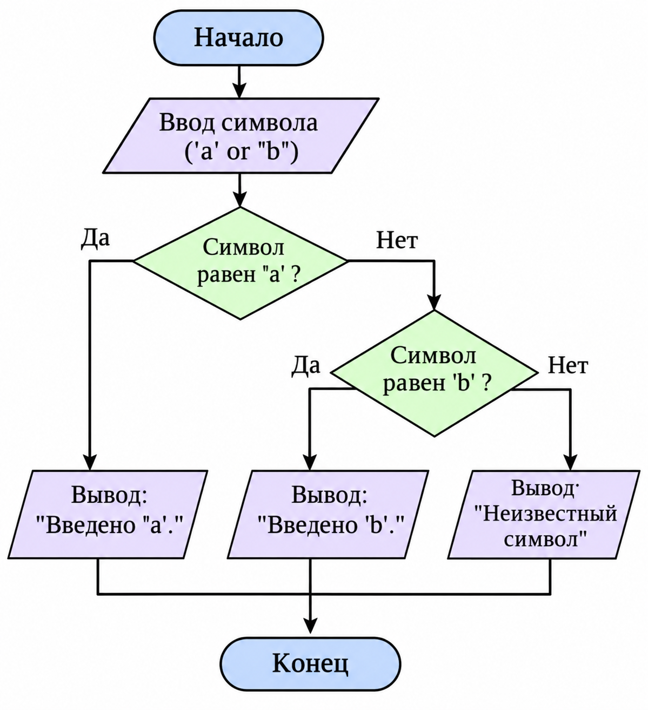

dd# Лабораторная работа №7

## Условие задачи

Написать программу, которая принимает один символ и определяет, является ли он латинской буквой, цифрой или другим символом. Для выбора результата использовать оператор switch.

## 1 Алгоритм и блок-схема

Начало программы.

Подключение библиотек stdio.h и locale.h.

Настройка локализации для вывода сообщений на русском языке.

Объявление переменной c типа char.

Вывод приглашения к вводу символа.

Ввод символа с помощью функции scanf.

Проверка символа с использованием оператора switch:

Если символ находится в диапазоне от a до z или от A до Z, вывести сообщение «Это буква».

Если символ находится в диапазоне от 0 до 9, вывести сообщение «Это цифра».

В противном случае вывести сообщение «Это не буква и не цифра».

Завершение программы.

## Блок-схема алгоритма

[Открыть блок-схему](images/blok7.png)
## 2. Реализация программы

## 3. Результат работы программы
Программа определяет чётные цифры четырёхзначного числа и выводит соответствующие сообщения.

## Информация о разработчике 
                                Запорин Артём, бТИИ-262
